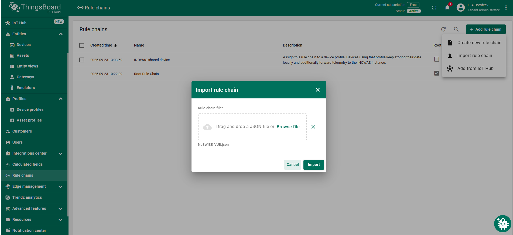
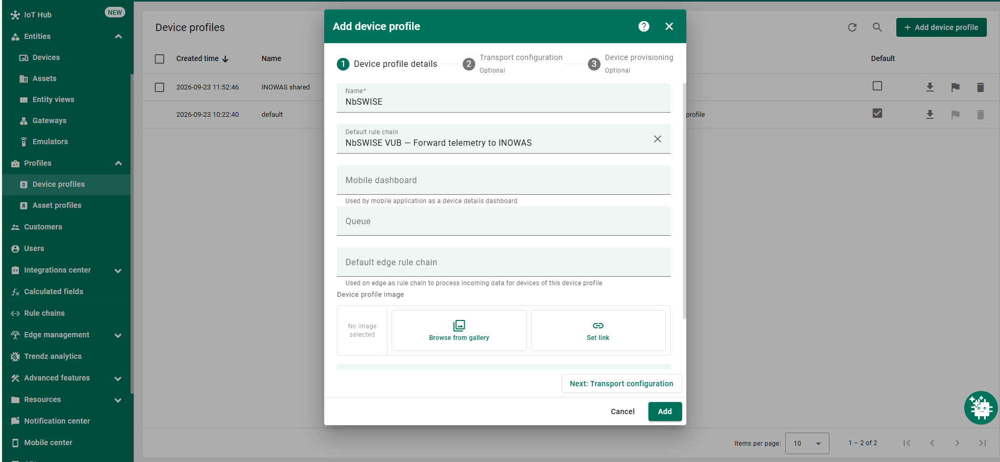
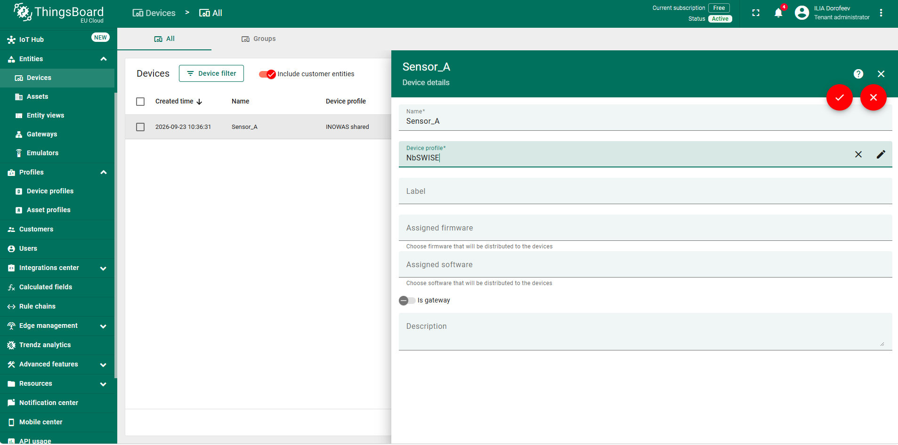

# Sharing of Telemetric Data

Internal documentation of the NbSWISE / VUB telemetry integration with INOWAS. This folder records the supplied Rule Chain configurations, how telemetry is forwarded and stored, and the setup procedure for colleagues.

**[Download the illustrated PDF guide](docs/Sharing_of_Telemetric_Data.pdf)** — full screenshots with red highlights and numbered actions.

Both Rule Chain JSON files are included exactly as supplied, including the sender endpoint and inbox token. The forwarding chain is configured for NbSWISE / VUB. The documentation below describes these configurations; a live deployment was not tested when preparing this folder.

| Chain | Install on | Documentation |
| --- | --- | --- |
| [NbSWISE_VUB.json](rule-chain/sender/NbSWISE_VUB.json) | Partner ThingsBoard instance | [Forwarding configuration](docs/partner-sender.md) |
| [inowas_partner_inbox.json](rule-chain/receiver/inowas_partner_inbox.json) | INOWAS instance, on the inbox device profile | [Receiving and storage](docs/inowas-receiver.md) |

## What you need

- Access to your ThingsBoard instance with permission to manage rule chains, device profiles and devices.
- The included [NbSWISE_VUB.json](rule-chain/sender/NbSWISE_VUB.json) for this integration.
- A list of devices whose telemetry you want to share.

The screenshots show an example configuration. Device names, profile names and Rule Chain names may differ in your instance.

## 1. Import the Rule Chain

1. Open **Rule chains** in the left menu.
2. Click **Add rule chain**.
3. Select **Import rule chain**.
4. Click **Browse file** and select the supplied JSON file.
5. Click **Import**.

## 2. Create a device profile

6. Open **Profiles → Device profiles**.
7. Click **Add device profile**.
8. Enter a profile name, for example **NbSWISE**.
9. In **Default rule chain**, select the Rule Chain you just imported.
10. Click **Add** to save the profile.

Use transport settings compatible with the devices you intend to share. The example Rule Chain name in the screenshot is **NbSWISE VUB — Forward telemetry to INOWAS**.

## 3. Assign the profile to selected devices

11. Open **Entities → Devices**.
12. Open a device you want to share and enter edit mode.
13. In **Device profile**, select the profile created above.
14. Click the **check mark** to save.

The screenshot below shows the device details already in edit mode. **Sensor_A** is an example device.

Start with one device. After the device sends a new measurement, check that the telemetry remains available in your ThingsBoard instance and confirm with INOWAS that it has arrived. Then repeat steps 11–14 for the other devices you want to share.

## Historical data

The setup above is intended for sharing incoming telemetry. Historical measurements must be exported separately from the selected devices and provided to INOWAS.

Export the telemetry using an available telemetry export tool or the ThingsBoard API. CSV or JSON is suitable; agree on the date range and telemetry keys with INOWAS before preparing the export. The precise export method depends on your ThingsBoard deployment and available tools.

Include the following information in the export or its accompanying description:

| Information | What to provide |
| --- | --- |
| Device | Device name or ID, consistently identifying each device |
| Time | Timestamp for every measurement, with time zone or UTC offset; for numeric timestamps, specify seconds or milliseconds |
| Measurement | Telemetry key and value |
| Units | Unit for each measurement key, where applicable |
| Coverage | Exported date range and any known gaps |

**Exporting a device configuration as JSON does not export its telemetry history.** The historical-data file must contain the actual measurements and their timestamps.

The sender JSON's original description mentions `migrate_history_to_inowas.py`. That companion script was not supplied and is not included in this repository. The export instructions above do not require it.

## If data does not arrive

| Check | What to verify |
| --- | --- |
| New measurement | The selected device has sent telemetry since the profile was assigned. |
| Device profile | The device uses the sharing profile and the change was saved. |
| Rule Chain selection | The sharing profile points to the imported Rule Chain. |
| Sender destination | The configured endpoint and token correspond to the intended INOWAS inbox device. |
| Local and received data | Compare the same device, telemetry key and timestamp in your instance and with INOWAS. |

If the issue continues, provide INOWAS with the device name, telemetry key and timestamp of a recent measurement so the transfer can be checked.

## Repository contents

| Path | Contents |
| --- | --- |
| `README.md` | Setup, verification and historical-data instructions |
| `docs/Sharing_of_Telemetric_Data.pdf` | Three-page illustrated guide with numbered red annotations |
| `docs/images/` | Three full original screenshots at their original resolution |
| `rule-chain/receiver/inowas_partner_inbox.json` | INOWAS receiving Rule Chain, supplied unchanged |
| `rule-chain/sender/NbSWISE_VUB.json` | Partner forwarding Rule Chain, supplied unchanged |
| `docs/partner-sender.md` | Sender configuration and processing behavior |
| `docs/inowas-receiver.md` | Receiving-side configuration, payload and processing behavior |
| `rule-chain/README.md` | Chain roles and configuration status |

Store the contents of this folder in the internal GitHub repository, preserving the directory structure so the relative links and screenshots remain available.
